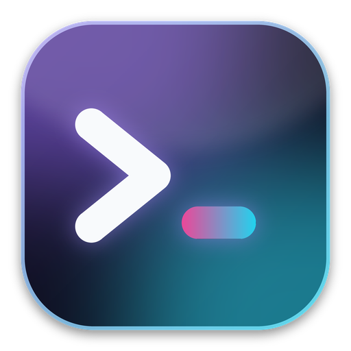
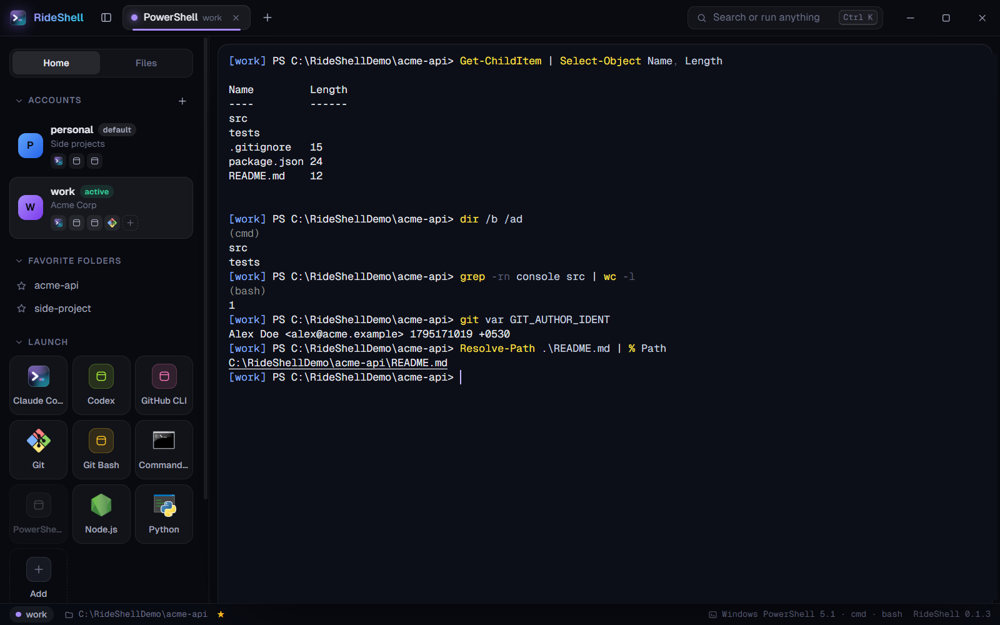
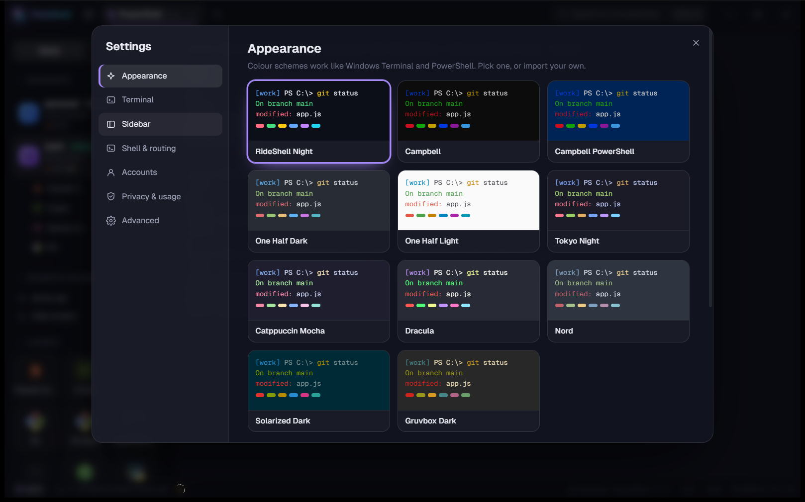

<p align="center">
  
</p>

<h1 align="center">RideShell</h1>

<!-- Live user count (anonymous totals from server/). After deploying the Worker, replace
     YOUR-WORKER with its address (e.g. rideshell-telemetry.you.workers.dev) and remove these
     comment markers:
<p align="center">
  
  
</p>
-->

<p align="center">
  <b>One terminal. Every shell. Every account.</b><br>
  PowerShell, cmd and bash in one window · separate Claude Code, Codex, GitHub and Git accounts side by side ·
  per-project API keys · offline, local, open source
</p>

<p align="center">
  
</p>

---

## Why RideShell

* **Many accounts, no mixing.** Your work and personal Claude Code (or Codex, GitHub CLI, Git
  identity) run **at the same time** in different tabs or folders. Each account has its own
  login, settings and history, kept apart by the tool's own config folder. No containers,
  no Docker, no VMs.
* **Every shell in one window.** It's real PowerShell, but `dir /s`, `set X=1`, `ls -la`,
  `export X=1` and `npm i && npm test` run in the shell they were written for. Line after line,
  in any order, with your folder and variables carried along.
* **Keys where they belong.** API keys live in Windows Credential Manager (or the macOS
  Keychain / Linux Secret Service), per account or per project. A key is handed to the program
  you launch and never left in your shell.
* **Folders pick the account.** Bind `C:\code\acme` to *work*, and every terminal (or `claude`)
  opened there is *work*, automatically.
* **A terminal you'll like using.** Tabs, the command palette, a files panel, real app icons,
  11 colour schemes (or import any Windows Terminal scheme), and one-click account switching.
* **Yours.** One executable, no sign-up, no cloud. Everything is stored on your PC, and it's
  MIT licensed.

## Install

**Windows 10/11:** download `rideshell.exe` from the
[latest release](https://github.com/gauravvvvvvvvvv/RideShell/releases/latest) and double-click it. It installs for your user,
**without admin rights**, and adds:

* the *RideShell* and *RideShell (Administrator)* Start menu entries, and a Windows Terminal profile;
* `rideshell` on your PATH, and **Open in RideShell** in Explorer's folder menu;
* an entry in *Settings → Apps*, for uninstalling like any other app.

Building from source: see [Build](#build).

## Quick start: two Claude Code accounts at once

```powershell
rideshell profile create personal      # your first account keeps your existing logins
rideshell profile create work          # every new account starts with its own, empty logins

rideshell auth login claude --profile work
```

Then, in RideShell App, click **work** or **personal** in the sidebar, or in any terminal:

```powershell
# Terminal 1                        # Terminal 2
rideshell profile use work          rideshell profile use personal
claude                              claude            # both run at the same time
```

```powershell
rideshell profile bind C:\code\acme work    # this folder (and below) is always "work"
rideshell run --profile personal -- claude  # one command, one account
```

`rideshell auth status` shows which account every profile is signed in as.

## RideShell App

| | |
|---|---|
|  |  |
| **Files:** favorites, places, project folders and a browser that follows the tab | **Settings:** themes like Windows Terminal, fonts, sidebar, shell, privacy |

* **Accounts sidebar:** one click switches the current tab's account, and **+** opens a new tab as
  it. Each account lists its tools with **Sign in** and **API key**, and a ⋯ menu. The sign-in guide
  explains how to use a different account in your browser, can pre-fill the e-mail, and offers
  a private window if *you* choose it.
* **Launch:** Claude Code, Codex, GitHub CLI, Git, Git Bash, Command Prompt, PowerShell 7,
  Node.js, Python, with their real icons. Missing ones offer their official installer.
  **Add** pins any installed tool. Right-click to remove one.
* **Installed tools** (`Ctrl+Shift+E`, or `rideshell tools`): every command-line tool on your
  PATH, by source (npm, winget, Scoop, cargo, Python, Git…). **Run** it, ☆ **pin** it, or
  **Route** it through RideShell so it uses your accounts in *every* terminal.
* **Files:**
  * **Open folder…** opens a tab in any folder. **Favorites** are starred with ☆.
  * **Places** include project folders, which open as their account.
  * **Recently worked** folders: from RideShell, and also from VS Code, Cursor, Claude Code
    and Codex (read locally, never sent anywhere).
  * A **Browse** list that follows the current tab: click to look inside, **cd** to go there,
    and click a file to insert its path.
  * Drag a folder onto the window, use **Open in RideShell** in Explorer, or type
    `rideshell` in Explorer's address bar.
* **Command palette** (`Ctrl+K`):
  
* **Administrator:** *Open as Administrator* opens a second, elevated window. The normal one
  never is.
* Every sidebar section collapses, and it's remembered.

Shortcuts: `Ctrl+T` new tab · `Ctrl+W` close · `Ctrl+Tab` next · `Ctrl+K` palette ·
`Ctrl+B` sidebar · `Ctrl+Shift+E` tools · `Ctrl+,` settings · `Ctrl+=`/`-` zoom ·
right-click copies a selection or pastes.

## One window, every shell

Each line is checked when you press Enter:

| You type | Runs in | Because |
|---|---|---|
| `Get-ChildItem -Recurse`, `git status`, `claude` | PowerShell | it is valid PowerShell |
| `dir /s /b`, `copy a b /y`, `cd /d D:\work` | cmd | `/switch` options |
| `set FOO=bar`, `echo %PATH%`, `ver`, `mklink /j a b` | cmd | cmd syntax and built-ins |
| `npm i && npm test` (Windows PowerShell 5.1) | cmd | 5.1 cannot parse `&&` |
| `ls -la`, `rm -rf build`, `export FOO=bar`, `FOO=1 npm test` | bash | POSIX flags and syntax |
| `cat log.txt \| grep error \| wc -l` | bash | `grep`/`wc` are not PowerShell commands |

* **One line, one shell, in any order.** The next line can be a different shell. `cd` and
  variables carry over: `set X=1` in cmd, then `$env:X` in PowerShell, then `echo $X` in bash.
  Exit codes come back as `$LASTEXITCODE`. A line is never split across shells.
* Force a shell with `@cmd …`, `@bash …` or `@ps …`. `rideshell dialect <line>` explains the
  choice.
* bash means Git Bash. zsh-style lines run in bash too, since zsh does not exist on Windows.
* It's real PowerShell (7 if installed, else 5.1) with your own profile, so modules, completion,
  history and interactive tools behave exactly as usual.

## Connect any tool

RideShell has no list of supported tools. **Connect a tool** shows the command-line tools
installed on your PC. When you pick one, RideShell reads that tool's own `--help` and
pre-fills what it finds:

* its **sign-in command** (`login`, `auth login`…);
* the **variables** it mentions for API keys or a config folder.

You confirm or edit them, or leave them empty. Afterwards the tool has **Sign in** and/or
**API key** buttons for that account.

* **Keys** are stored in the OS credential store and given to the tool when that account runs it.
* **A config-folder variable** gives the account its own folder for that tool. It reaches only
  that tool, never other programs.
* **Built in** are only the accounts RideShell is about: Claude Code, Codex and GitHub CLI
  (their own config folders, plus conversation history) and Git (commit identity).

```powershell
rideshell inspect vercel                       # what vercel's own help offers
rideshell identity set work custom tool=vercel "login=login" key_vars=VERCEL_TOKEN
rideshell auth login custom-vercel --profile work
```

## Your Claude Code and Codex conversations

Claude Code and Codex keep your conversations (what `claude --resume` lists) in their config
folder. A new account keeps its own sign-in but **shares conversation history** with the
original folder by default, so `claude --resume` still lists the conversations you already had.
Per account you can change that:

* **Use the original folder** (`~/.claude`, `~/.codex`): the account uses your existing
  sign-in **and** all your conversations. Conversations it had in its own folder are moved over,
  and nothing is overwritten. Your *first* account does this automatically.
* **Share history** (the default for new accounts): the account keeps its **own** sign-in but
  sees the same conversations (a folder link, so no copies).
* **Separate**: the account gets its own, empty history (`rideshell history separate`).

```powershell
rideshell history status                       # where each account's conversations live
rideshell history adopt claude --profile personal
rideshell history share claude --profile work  # `separate` undoes it
```

Only conversation files are moved or linked. Sign-in files are never touched.

## Accounts, keys and any tool

```powershell
rideshell secret set ANTHROPIC_API_KEY --profile work          # hidden prompt, OS credential store
rideshell secret set ANTHROPIC_API_KEY --dir C:\code\client-a   # this project uses its own key
rideshell profile env set work AWS_PROFILE corp-prod            # plain settings
rideshell identity set work git name="Alex Doe" email=alex@acme.example
rideshell shim add wrangler                                     # any tool, every terminal
```

* **Isolation:** each account gets its own folder via the variable the tool supports:
  `CLAUDE_CONFIG_DIR`, `CODEX_HOME`, `GH_CONFIG_DIR`. RideShell never reads, copies or moves
  tokens.
* **Shims:** typing `claude`, `codex` or `gh` in *any* terminal starts the real tool with the
  right account. That includes PowerShell, cmd, Git Bash and VS Code. If a terminal points at
  a deleted profile, the shim refuses to run rather than use the wrong account.
* **Which account is active?** Highest wins:
  1. `--profile`
  2. `rideshell profile use` (this terminal)
  3. the deepest bound folder
  4. the default profile

  `rideshell profile why` explains the choice.

## Privacy

RideShell is local software. It has no account, no cloud and no background service.

* **What stays on your PC:**
  * profiles, folder bindings and settings (in SQLite and TOML);
  * secrets (in the OS credential store);
  * your own **usage stats**, in *Settings → Privacy & usage*: time used per day and sessions.
    Only you see them.
* **Never collected:** commands, folders, file names, accounts, tool names, output, keys.
* **Optional anonymous user count:** official builds may count how many people use RideShell
  and for how long. It sends a random ID that **changes every day**, the version, the OS family
  and active minutes, at most every 5 minutes while the app is open. The server stores no IP
  addresses.
  * It's **off in builds from source**. It only exists when built with `RIDESHELL_TELEMETRY_URL`.
  * Users can switch it off in Settings, or with `DO_NOT_TRACK=1` / `RIDESHELL_NO_TELEMETRY=1`.
  * The server and dashboard are in [`server/`](server/), so you can see exactly what is
    stored.
* **Optional one-line message slot:** official builds may show one line of text in the status
  bar, fetched with no ID, cookies or referrer, so it cannot track you. Builds from source
  leave it out (`RIDESHELL_PROMO_URL`).

## Build

Requires Rust 1.80+ and, on Windows, the MSVC build tools.

```powershell
cargo test                                                   # unit + end-to-end tests
cargo build --release -p rideshell-cli                       # rideshell.exe (CLI, shims, installer)
powershell -ExecutionPolicy Bypass -File scripts\build-release.ps1   # single exe that includes RideShell App
```

Optional build-time settings (unset by default): `RIDESHELL_TELEMETRY_URL` (anonymous user
count) and `RIDESHELL_PROMO_URL` (status-bar message). `python scripts/make-icon.py`
regenerates the icon.

| Path | What |
|---|---|
| `crates/rideshell-core` | Profiles, resolution, environment planning, providers, vault, shells, dialect routing |
| `crates/rideshell-cli` | `rideshell` command, shims, installer, RideShell window (console) |
| `crates/rideshell-app` | RideShell App (tao + wry/WebView2 + xterm.js + ConPTY) |
| `server/` | Optional anonymous usage counter (Cloudflare Worker + D1) and owner dashboard |
| `scripts/` | Release build, icon generator |

## Status

v0.1, early but solid on **Windows 11**. Tested there:

* Windows PowerShell 5.1, Git Bash and cmd (automated, real shells);
* the RideShell window in a real interactive console;
* Claude Code and Codex login separation.

Implemented but not yet tested: PowerShell 7 as the tab engine, zsh, macOS and Linux. The UAC
prompt itself and the native folder picker need a person, so they aren't automated. See
[ROADMAP.md](ROADMAP.md).

## Documentation

[ARCHITECTURE.md](ARCHITECTURE.md) · [ROADMAP.md](ROADMAP.md) · [CHANGELOG.md](CHANGELOG.md) ·
[CONTRIBUTING.md](CONTRIBUTING.md) · [SECURITY.md](SECURITY.md)

## Third-party components

RideShell App bundles [xterm.js](https://github.com/xtermjs/xterm.js) (MIT) and the
[Geist](https://github.com/vercel/geist-font) fonts (SIL OFL 1.1). Their licenses are in
[`crates/rideshell-app/assets/vendor/`](crates/rideshell-app/assets/vendor/).

## License

[MIT](LICENSE)
