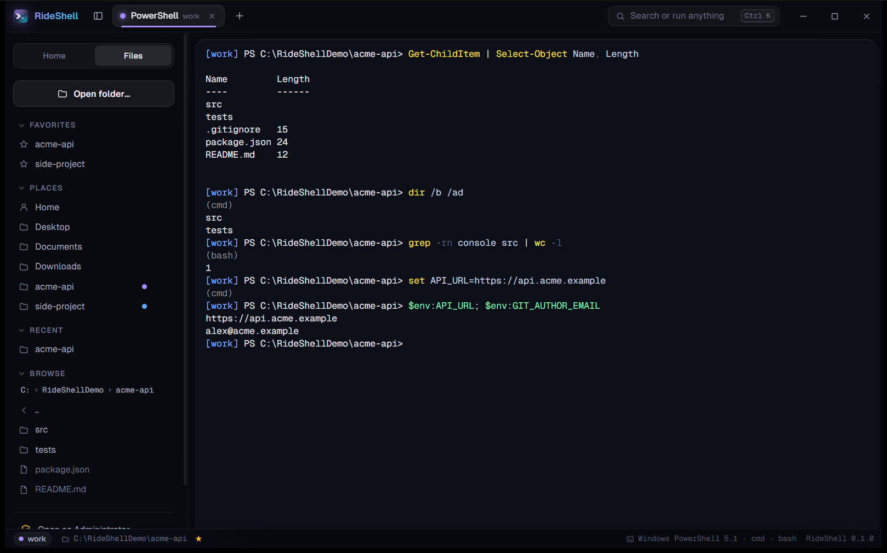
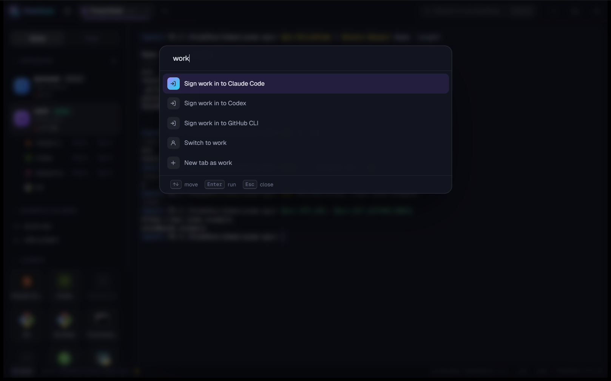

<p align="center">
  
</p>

<h1 align="center">RideShell</h1>

<!-- Live user count (anonymous totals from server/). After deploying the Worker, replace
     YOUR-WORKER with its address (e.g. rideshell-telemetry.you.workers.dev) and remove these
     comment markers:
<p align="center">
  
  
</p>
-->

<p align="center">
  <b>Every account. Side by side. In one terminal.</b><br>
  Work and personal Claude Code, Codex, GitHub CLI and Git identities at the same time ·
  folders that pick the right account · PowerShell, cmd and bash in one window ·
  local, open source
</p>

<p align="center">
  <a href="https://github.com/gauravvvvvvvvvv/RideShell/releases/latest"><b>Download for Windows</b></a> ·
  <a href="#linux">Linux CLI</a> ·
  <a href="CHANGELOG.md">What's new</a>
</p>

<p align="center">
  
</p>

---

## Why RideShell

* **Many accounts, never mixed.** Your work and personal Claude Code (or Codex, GitHub CLI,
  Git identity) run **at the same time**, in different tabs or folders. Each account has its
  own sign-in, settings and conversations, kept apart by the tool's own config folder. No
  containers, no VMs, no logging in and out.
* **Folders pick the account.** Bind `C:\code\acme` to *work*: every RideShell tab there is
  *work*, and `claude`, `gh` or `git` started there use work's sign-in and identity.
* **Safe by default.** Switching accounts never types into a running program. Before
  `git push`, `gh pr create` or a deploy as the *wrong* account for a folder, RideShell asks.
  Profiles never leak into your other terminals.
* **Keys where they belong.** API keys live in Windows Credential Manager (or the macOS
  Keychain / Linux Secret Service), per account or per project, and are handed only to the
  program you launch.
* **Every shell in one window.** It's real PowerShell, but `dir /s`, `set X=1`, `ls -la`,
  `export X=1` and `npm i && npm test` run in the shell they were written for, line after
  line, with your folder and variables carried along.
* **A terminal you'll like using.** Tabs, a command palette, a files panel, clickable paths,
  real app icons, 11 colour schemes (or any Windows Terminal scheme), and it stays fast.
* **Yours.** One download, no sign-up, no cloud. Signed updates. MIT licensed.

## Install

### Windows 10/11

Download **`rideshell.exe`** from the
[latest release](https://github.com/gauravvvvvvvvvv/RideShell/releases/latest) and
double-click it. An install wizard opens. It installs for your user, **without admin
rights**, and adds:

* *RideShell* and *RideShell (Administrator)* to the Start menu, and a Windows Terminal profile;
* `rideshell` on your PATH, and **Open in RideShell** in Explorer's folder menu;
* an entry in *Settings → Apps* (with its size, version and links), to uninstall like any app.

**Updates come to you.** RideShell App checks for new versions and offers them in a popup.
An update installs only if it carries the project's **release signature** (Ed25519) and
matches its signed checksum list. Then it installs without a terminal window and restarts
when you say so (*Settings → Updates*).

The files aren't code-signed (Authenticode) yet, so Windows SmartScreen may warn on the first
download: *More info → Run anyway*. Each release lists its SHA-256 checksums if you want to
check the download.

### Linux

The `rideshell` command-line tool for x86-64 Linux with glibc 2.31+ (Ubuntu 20.04+, Debian 11+,
Fedora, Arch…). RideShell App is Windows-only for now.

```bash
curl -fLO https://github.com/gauravvvvvvvvvv/RideShell/releases/latest/download/rideshell-linux-x86_64.tar.gz
tar xzf rideshell-linux-x86_64.tar.gz && install -m755 rideshell ~/.local/bin/
rideshell shell install bash        # or zsh: per-folder accounts in your shell, tools routed
```

Building from source: see [Build](#build).

## Quick start: two Claude Code accounts at once

```powershell
rideshell profile create personal      # your first account keeps your existing logins
rideshell profile create work          # a new account starts with its own, empty logins
```

In RideShell App, click **work** or **personal** in the sidebar (or **+** for a new tab as that
account). In any RideShell terminal:

```powershell
# Tab 1                             # Tab 2
rideshell profile use work          rideshell profile use personal
claude                              claude            # both run at the same time
```

The first time you run `claude` (or `codex`, `gh`) as a new account, the tool asks you to sign
in the way it always does. That sign-in is saved to that account only. RideShell has no
sign-in screens of its own.

```powershell
rideshell profile bind C:\code\acme work    # this folder (and everything below) is "work"
rideshell run --profile personal -- claude  # one command as one account, from any terminal
```

**Which account is active?** Highest wins: `--profile` › `rideshell profile use` (this
terminal) › the deepest bound folder › the default account. `rideshell profile why` explains.

### Wrong-account guard

If a terminal was switched to another account and you run a sensitive command in a folder
bound to a *different* account, RideShell asks first:

```text
warning: this folder belongs to work, but this terminal is using personal (switched with `profile use`)
Run `git push` as personal? [y/N]
```

Guarded by default: `git push`, `gh pr create/merge`, `gh release create`, `gh repo
create/delete`, `wrangler deploy`, `vercel deploy` / `--prod`, `netlify deploy`, `fly deploy`,
`npm/pnpm/yarn publish`, `cargo publish`, `docker push`, `terraform apply`, `kubectl apply`,
`firebase deploy`. Edit the list under `[guard]` in the config file. With no terminal to ask
in (scripts), it refuses. `RIDESHELL_GUARD=0` skips it once. Subcommands are matched in order,
so `git log --grep push` isn't treated as a push.

**The guard only sees tools routed through RideShell:** `claude`, `codex`, `gh`, `git` (once a
Git identity is connected) and anything you `rideshell shim add`. A guarded tool that isn't
routed (for example `npm` or `docker` before `rideshell shim add npm`) runs unchecked, and so
does any tool started outside RideShell. `rideshell doctor` lists which guarded tools are
protected and which installed ones aren't.

## RideShell App

| | |
|---|---|
|  |  |
| **Files:** favorites, places, project folders and a browser that follows the tab | **Settings:** themes like Windows Terminal, fonts, sidebar, shell, updates, privacy |

* **Accounts:** one click switches the tab's account. The switch happens only at an idle
  prompt and shows as done only when the shell confirms it. If a program (Claude Code, an
  editor) is running in the tab, the account opens in a **new tab in the same folder**
  instead. Each account shows its tools as **small icons**: click one for its options
  (conversation history, disconnect), **+** connects another tool. A green dot means the
  tool uses your original folder or shared history.
* **Launch:** Claude Code, Codex, GitHub CLI, Git, Git Bash, Command Prompt, PowerShell 7,
  Node.js, Python, with their real icons. Missing ones offer their official installer, and a
  tool you install while the app is open **appears without a restart**. **Add** pins any
  installed tool; right-click to remove one.
* **Clickable paths:** file and folder paths printed in a tab (`C:\…`, `"C:\Program Files\…"`,
  `~\…`, `%USERPROFILE%\…`, `/c/…`, `src/main.rs:12:5`, even when wrapped over two rows) open
  in Explorer with the file selected. Web links open in your browser.
* **Installed tools** (`Ctrl+Shift+E`, or `rideshell tools`): every command-line tool on your
  PATH, by source (npm, winget, Scoop, cargo, Python, Git…). **Run** it, ☆ **pin** it, or
  **Route** it through RideShell so it uses your accounts in RideShell terminals.
* **Files:**
  * **Open folder…** opens a tab in any folder. **Favorites** are starred with ☆.
  * **Places** include project folders, which open as their account.
  * **Recently worked** folders: from RideShell, and also from VS Code, Cursor, Claude Code
    and Codex (read locally, never sent anywhere).
  * A **Browse** list that follows the current tab: click to look inside, **cd** to go there,
    and click a file to insert its path.
  * Drag a folder onto the window, use **Open in RideShell** in Explorer, or type
    `rideshell` in Explorer's address bar.
* **Command palette** (`Ctrl+K`): accounts, apps, folders, tools and settings.
  
* **Now playing:** while Spotify plays, the status bar shows the song with previous /
  play-pause / next (Windows media controls; no sign-in).
* **Administrator:** *Open as Administrator* opens a second, elevated window. The normal one
  never is.
* **Fast:** everything slow (scans, folder listings, account creation, update checks) runs in
  the background, and each tab has its own input path, so typing never waits.

Shortcuts: `Ctrl+T` new tab · `Ctrl+W` close · `Ctrl+Tab` next · `Ctrl+K` palette ·
`Ctrl+B` sidebar · `Ctrl+Shift+E` tools · `Ctrl+,` settings · `Ctrl+=`/`-` zoom ·
right-click copies a selection or pastes.

## One window, every shell

Each line is checked when you press Enter:

| You type | Runs in | Because |
|---|---|---|
| `Get-ChildItem -Recurse`, `git status`, `claude` | PowerShell | it is valid PowerShell |
| `dir /s /b`, `copy a b /y`, `cd /d D:\work` | cmd | `/switch` options |
| `set FOO=bar`, `echo %PATH%`, `ver`, `mklink /j a b` | cmd | cmd syntax and built-ins |
| `npm i && npm test` (Windows PowerShell 5.1) | cmd | 5.1 cannot parse `&&` |
| `ls -la`, `rm -rf build`, `export FOO=bar`, `FOO=1 npm test` | bash | POSIX flags and syntax |
| `cat log.txt \| grep error \| wc -l` | bash | `grep`/`wc` are not PowerShell commands |

* **One line, one shell, in any order.** The next line can be a different shell. `cd` and
  variables carry over: `set X=1` in cmd, then `$env:X` in PowerShell, then `echo $X` in bash.
  Exit codes come back as `$LASTEXITCODE`. A line is never split across shells.
* When unsure, a line runs in **PowerShell**. Force a shell with `@cmd …`, `@bash …` or
  `@ps …`. `rideshell dialect <line>` explains the choice.
* bash means Git Bash. It's real PowerShell (7 if installed, else 5.1) with your own profile,
  so modules, completion, history and interactive tools behave exactly as usual.

## Your Claude Code and Codex conversations

Claude Code and Codex keep conversations (what `claude --resume` lists) in their config
folder. A new account starts with **its own, private** history, so work and personal never
mix. To bring your existing conversations into an account:

* **Use the original folder** (`~/.claude`, `~/.codex`): the account uses your existing
  sign-in **and** all your conversations. Your *first* account does this automatically.
* **Share history:** the account keeps its **own** sign-in but sees the same conversations
  (a folder link, no copies). Every account that shares sees all of them.
* **Separate:** back to its own history.

```powershell
rideshell history status                       # where each account's conversations live
rideshell history share claude --profile work  # `adopt` / `separate` likewise
```

To share for every new account: *Settings → Profiles → Share conversation history with new
accounts*, or `share_new_accounts = true` under `[history]` in the config file. Only
conversation files are moved or linked; sign-in files are never touched.

## Keys, identities and any tool

```powershell
rideshell secret set ANTHROPIC_API_KEY --profile work          # hidden prompt, OS credential store
rideshell secret set ANTHROPIC_API_KEY --dir C:\code\client-a   # this project uses its own key
rideshell profile env set work AWS_PROFILE corp-prod            # plain settings
rideshell identity set work git name="Alex Doe" email=alex@acme.example
rideshell shim add wrangler                                     # route any tool through RideShell
```

* **Isolation:** each account gets its own folder via the variable the tool supports:
  `CLAUDE_CONFIG_DIR`, `CODEX_HOME`, `GH_CONFIG_DIR`. RideShell never reads, copies or moves
  tokens.
* **Shims** (`claude`, `codex`, `gh`, `git`, …) start the real tool as the right account
  **inside RideShell** (the app, a RideShell window, or a shell with `rideshell shell
  install`). In any other terminal they run the tool exactly as installed. If a terminal points
  at a deleted account, the shim refuses to run rather than use the wrong one.
* **Any tool:** RideShell has no list of supported tools. **Connect a tool** reads the tool's
  own `--help` and suggests the variables it mentions for API keys or a config folder (that
  folder then becomes per account). To sign in, run the tool as that account.

```powershell
rideshell inspect vercel                       # what vercel's own help offers
rideshell identity set work custom tool=vercel folder_var=VERCEL_HOME key_vars=VERCEL_TOKEN
```

## Privacy

RideShell is local software. It has no account, no cloud and no background service.

* **What stays on your PC:** accounts, folder bindings and settings (SQLite and TOML), secrets
  (OS credential store), and your own **usage stats** in *Settings → Privacy & usage*.
* **Never collected:** commands, folders, file names, accounts, tool names, output, keys.
* **Update check:** RideShell App asks GitHub's public API for the latest release shortly
  after start and every 6 hours, with no ID (only a `RideShell-updater/<version>` user agent).
  Turn it off in *Settings → Updates*. Nothing installs without your OK.
* **Optional anonymous user count** (official builds only, off in builds from source): a random
  ID that **changes every day**, the version, the OS family and active minutes, at most every
  5 minutes while the app is open. No IP addresses are stored. Switch it off in Settings or
  with `DO_NOT_TRACK=1`. The server is in [`server/`](server/).
* **Optional one-line message slot** (official builds only): one line of text in the status
  bar, fetched with no ID, cookies or referrer.

Details: [SECURITY.md](SECURITY.md).

## Build

Requires Rust 1.80+ and, on Windows, the MSVC build tools.

```powershell
cargo test                                                   # unit + end-to-end tests
cargo build --release -p rideshell-cli                       # rideshell(.exe): CLI, shims, installer
powershell -ExecutionPolicy Bypass -File scripts\build-release.ps1   # Windows exe with RideShell App inside
```

Releases are signed with the maintainer's offline key (`rideshell-release sign`); the steps,
including the Linux build in Docker, are in [CONTRIBUTING.md](CONTRIBUTING.md).

| Path | What |
|---|---|
| `crates/rideshell-core` | Accounts, resolution, environment, providers, vault, shells, routing, guard, history, release signatures |
| `crates/rideshell-cli` | `rideshell` command, shims, installer, RideShell window (console) |
| `crates/rideshell-app` | RideShell App (tao + wry/WebView2 + xterm.js + ConPTY), updater, setup wizard |
| `crates/rideshell-release` | Maintainer tool: release key and signing (not shipped) |
| `server/` | Optional anonymous usage counter (Cloudflare Worker + D1) and owner dashboard |
| `scripts/` | Release build, icon generator |

## Status

v0.1, early but solid. Tested:

* **Windows 11:** Windows PowerShell 5.1, Git Bash and cmd (automated, real shells); the
  RideShell window in a real console; Claude Code and Codex sign-in separation; the app driven
  end to end (account switching, clickable paths; the update and setup wizards with simulated
  progress).
* **Linux (CLI):** the full test suite on Debian 11; clean Ubuntu 22.04, Ubuntu 24.04 and
  Debian 11 installs with two accounts, per-folder switching in interactive bash and tool
  shims; keys stored in a real GNOME Keyring (Secret Service), kept apart per account.
* **Updates:** downloaded from GitHub and verified against the signed checksum list.

Not yet tested: PowerShell 7 as the tab engine, zsh, macOS, KWallet. The UAC prompt and the
native folder picker need a person, so they aren't automated. See [ROADMAP.md](ROADMAP.md).

## Documentation

[CHANGELOG.md](CHANGELOG.md) · [ARCHITECTURE.md](ARCHITECTURE.md) · [ROADMAP.md](ROADMAP.md) ·
[CONTRIBUTING.md](CONTRIBUTING.md) · [SECURITY.md](SECURITY.md)

## Third-party components

RideShell App bundles [xterm.js](https://github.com/xtermjs/xterm.js) (MIT) and the
[Geist](https://github.com/vercel/geist-font) fonts (SIL OFL 1.1). Their licenses are in
[`crates/rideshell-app/assets/vendor/`](crates/rideshell-app/assets/vendor/).

## License

[MIT](LICENSE)
